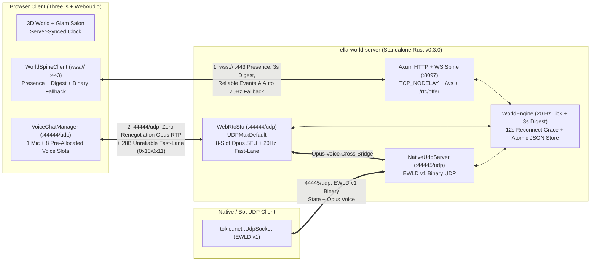

# ELLA World — Hybrid WebSocket Spine + Zero-Renegotiation UDP SFU Architecture (`v0.3.0`)

## 1. System Overview

ELLA World is architected as a self-contained Rust server (`ella-world-server`) with zero runtime dependencies on Node.js, Express, Server-Sent Events (SSE), HTTP `/sync` polling, or external databases.

In `v0.3.0`, ELLA World pairs a **Persistent Binary + JSON WebSocket Spine (`443/tcp` `TCP_NODELAY`)** with a **Zero-Renegotiation Single-Port Multiplexed UDP Fast-Lane + 8-Slot Opus SFU (`44444/udp`)**:

---

## 2. Hybrid Dual-Plane Reliability Design

### Plane A — Authoritative Persistent WebSocket Spine (`src/ws_spine.rs`, `wss://<host>/api/ella-world/ws`)
1. **Exclusive Presence Ownership & 12-Second Reconnect Grace**: WebRTC ICE hiccups never evict a player from `WorldEngine::players`. Only an explicit `/logout` or a WebSocket disconnect exceeding the **12-second grace window** broadcasts `player_leave`. Reconnecting within 12 seconds cancels eviction seamlessly with zero "left/joined" flicker.
2. **Self-Healing 3-Second `world_sync_digest`**: Every 3 seconds, the server broadcasts a compact authoritative digest (`stateSeq`, `serverTimeMs`, `blocksVersion`, `players` with 16-hex SHA-256 `avatarHash`, and `runway` summary). Any client that missed an outfit change, player join, or voxel block build automatically detects the version/hash delta and heals within ≤3 seconds.
3. **Instant Automatic 20 Hz Binary Fallback**: Whenever a client's UDP `44444` fast-lane is handshaking, reconnecting, or blocked by strict carrier/guest-Wi-Fi firewalls, the exact same 28-byte `OP_C2S_STATE` (`0x10`) and `OP_S2C_WORLD_STATE` (`0x11`) binary frames flow over the `TCP_NODELAY` WebSocket at 20 Hz—promoting automatically to `44444/udp` the instant live UDP pongs confirm reachability.
4. **Server-Synchronized World Clock (`serverTimeMs`)**: Clients lock `serverClockOffsetMs` via RTT-compensated `ping`/`pong` frames so moving Sky Obby platforms, disco floor tiles, and runway strip lights are phase-locked across every device.

### Plane B — Zero-Renegotiation Single-Port UDP Fast-Lane + 8-Slot Opus SFU (`src/webrtc_sfu.rs`, `44444/udp`)
1. **Single-Port `UDPMuxDefault` (`44444/udp`)**: All browser ICE connectivity checks, `DTLS-SRTP` Opus audio packets, and `SCTP/DTLS` binary game-state datagrams multiplex over **one UDP port (`44444/udp`)** with dual LAN `typ host` + WAN `typ srflx` ICE candidates.
2. **Pre-Allocated 8-Slot Speaker Pool (Zero SDP Renegotiation)**: During the initial `POST /api/ella-world/rtc/offer` handshake, the browser offers 1 `sendonly` Opus mic transceiver plus **8 `recvonly` Opus speaker slot transceivers**, which `WebRtcSfu` binds immediately to `ella_slot_0`..`ella_slot_7` (`TrackLocalStaticRTP`). When friends join, speak, or leave, the Rust SFU dynamically maps active speakers to free slots in user-space RTP memory and emits a lightweight `voice_slot_map` JSON event—**zero mid-game `setRemoteDescription` renegotiations, zero ICE restarts, and zero transceiver envelope errors**.
3. **Zero Head-of-Line Blocking (`ella-udp-state`)**: Movement, animations, runway poses, and speaking flags travel over `ordered: false, maxRetransmits: 0` SCTP/UDP datagrams when healthy.

---

## 3. Binary State Codec (`src/udp_wire.rs`)

Shared identically across WebRTC `ella-udp-state` (`44444/udp`), WebSocket Binary Fallback (`443/tcp`), and Native `EWLD` (`44445/udp`):

### Client-to-Server `OP_C2S_STATE` (`0x10` — Fixed 28 Bytes)

| Byte Offset | Type | Field | Description |
| :--- | :--- | :--- | :--- |
| `0` | `u8` | `opcode` | `0x10` (`OP_C2S_STATE`) |
| `1..5` | `u32 LE` | `seq` | Shared monotonic sequence number across WS & UDP |
| `5..9` | `u32 LE` | `client_time_ms` | Client monotonic ms timestamp echoed back for live RTT calculation |
| `9..13` | `f32 LE` | `x` | World X coordinate (`[-80.0, 80.0]`) |
| `13..17` | `f32 LE` | `y` | World Y elevation (`[-20.0, 80.0]`) |
| `17..21` | `f32 LE` | `z` | World Z coordinate (`[-80.0, 80.0]`) |
| `21..25` | `f32 LE` | `ry` | Character yaw rotation in radians |
| `25` | `u8` | `anim` | `0=idle`, `1=walk`, `2=run`, `3=jump` |
| `26` | `u8` | `emote` | `0=none`, `1=pose`, `2=peace`, `3=dance`, `4=spin`, `5=wave`, `6=cheer`, `7=flip`, `8=sit` |
| `27` | `u8` | `flags` | Bit `0`: `muted`, Bit `1`: `speaking`, Bits `2..7`: `zone` (`0 = ZONE_PLAZA`, `1 = ZONE_DUNGEON`, `2 = ZONE_PRISON`) |

### Server-to-Client `OP_S2C_WORLD_STATE` (`0x11` — Zone-Partitioned Compact Snapshot)

- Header (`11 bytes`): `[0x11][server_tick: u32 LE][echo_client_time_ms: u32 LE][player_count: u16 LE]`
- Per Remote Player (`1 + id_len + 19 bytes`): `[id_len: u8][id_utf8][x: f32 LE][y: f32 LE][z: f32 LE][ry: f32 LE][anim: u8][emote: u8][flags: u8]`
- **Zero-Byte-Overhead Zone Partitioning**: `WorldEngine::rebuild_pre_encoded_tick` buckets pre-encoded player frames into `entries_by_zone` (`ZONE_PLAZA = 0`, `ZONE_DUNGEON = 1`, `ZONE_PRISON = 2`). Peers only receive 20 Hz movement frames for remote players sharing their active zone, while `playersMap` and 8-slot Opus Party Voice remain connected across zones (unless muted by parental controls).

### Native Raw UDP Envelope (`44445/udp`)

Raw UDP datagrams on `44445/udp` prefix a 6-byte magic header `[b"EWLD"][version = 1][pkt_type]` supporting `OP_HELLO` (`0x01`), `OP_WELCOME` (`0x02`), `OP_C2S_STATE` (`0x10`), `OP_S2C_WORLD_STATE` (`0x11`), `OP_C2S_PING` (`0x12`), `OP_S2C_PONG` (`0x13`), `OP_VOICE_OPUS` (`0x20` cross-bridged into the 8-slot WebRTC SFU), and `OP_EVENT_JSON` / `OP_EVENT_ACK` (`0x30`/`0x31`).

---

## 4. Crystal Cavern Dungeon, Persistent Economy & Scam-Proof P2P Trading (`src/economy.rs`)

### 4.1 Multi-Zone Portal & Active-Only 4 Hz Dungeon Simulation
- **Portals**: Players transition between **Starlight Plaza (`ZONE_PLAZA = 0`)** via the East Plaza portal at `(18, 0, 16)` (or HUD shortcut `G`) and the **Crystal Cavern (`ZONE_DUNGEON = 1`)** return portal at `(0, 0, 28)`. Only Plaza coordinates persist to `UserAccount::last_pos`.
- **Dungeon Entities (< 128 KiB Server RAM)**:
  - **6 Crystal Veins** (`crystal_1`..`crystal_6`, 14s respawn) + **2 Wooden Chests** (28s respawn) + **2 Key-Locked Golden Vault Chests** (consume `1x dungeon_key`, 65s respawn).
  - **8 Patrolling Mobs**: 5 Shadow Slimes (`2 HP`) and 3 Crystal Bats (`3 HP`) defeated via **Jump-Stomp** (`2 dmg` + bounce) or **Sparkle Blast** (`E`, `1 dmg`).
  - **4 Hz Active-Only Tick (`tick_dungeon_if_occupied`)**: Runs every 250ms (`tick_seq % 5 == 0`) **only** when `>= 1` player occupies `ZONE_DUNGEON`, broadcasting compact `DungeonMobs` / `DungeonSync` updates exclusively to dungeon occupants.

### 4.2 18-Item Catalog, Legendary Ray Gun, Home Interiors & Exclusive Glam Ownership Reconciliation
- **Materials, Keys & 3D Home Trophy Relics**: `star_shard`, `slime_gel`, `moon_opal`, `dungeon_key`, `crown_relic`, `geode_lamp`, `slime_lava_lamp`, `bat_plushie`, `royal_chalice`, and `dragon_egg_relic`.
- **Consumables (`POST /api/ella-world/economy/use`)**: `speed_potion` (`+35%` sprint for 45s), `jump_potion` (`+30%` jump boost for 45s), and `prism_block` (places a glowing `#67e8f9` voxel block at the player's Plaza feet).
- **Dungeon-Exclusive 3D Glam Relics & First Legendary Weapon**:
  - `cosmetic_hat_shadow_hood` → `hat = "ninja"`
  - `cosmetic_acc_star_lantern` → `accessory = "star_lantern"`
  - `cosmetic_hat_obsidian_crown` → `hat = "obsidian_crown"`
  - `cosmetic_acc_crystal_wings` → `accessory = "crystal_wings"`
  - `legendary_ray_gun` (*legendary*, `10%` Golden Vault Chest jackpot) → `accessory = "ray_gun"`, granting a `14.5m` `3 HP` ranged plasma beam in Crystal Cavern (`POST /api/ella-world/dungeon/attack` with `mode: "raygun"`) plus harmless Starlight Plaza laser light-show beams (`POST /api/ella-world/raygun` / `"raygun_zap"`).
- **2-Story House Collisions, Hinged Doors/Windows & Anti-Duplication Loot Decorating (`POST /api/ella-world/block`)**:
  - `VoxelBlock` supports backward-compatible `kind`, `rot` (`0..3`), `open` (`action: "toggle"` for `door` & `window`), and `lootItemId` (`kind: "loot_decor"` with atomic `-1` placement deduction, owner-only removal, and `+1` refund on pickup or `POST /api/ella-world/admin/world/reset`). See [`docs/housing_interiors_and_legendary_loot.md`](housing_interiors_and_legendary_loot.md).
- **Server-Side Ownership Enforcement (`reconcile_equipped_cosmetics`)**: Verified on `POST /api/ella-world/avatar`, `loot_decor` pedestal placement, and P2P trade completion. Trading away or displaying the last copy of an equipped dungeon relic or Legendary Ray Gun automatically unequips it back to `"crown"` / `"none"` and broadcasts `avatar_updated`.

### 4.3 Scam-Proof Two-Sided Atomic Live P2P Trading
- **No NPC Shop / Pure Player Economy**: Friends exchange farmed Coins, Keys, Potions, Relics, and Exclusive Cosmetics directly via live P2P trade invites (`/api/ella-world/trade/invite`, `/respond`, `/offer`, `/lock`, `/confirm`, `/cancel`).
- **Anti-Bait Lock Reset**: Modifying coins or item stacks on either side increments `offer_revision` and resets `locked = false` and `confirmed = false` on **both** sides so neither player can confirm an altered offer without re-inspecting and re-locking.
- **Single-Guard Atomic Swap**: When the second party confirms, `WorldEngine::trade_confirm` acquires a single `users_cfg.write().await` guard, locates both accounts via disjoint mutable slice splits (`split_at_mut`), re-verifies exact coin balances, item stack quantities, and `MAX_ITEM_STACK` (`999`) bounds, transfers assets with zero duplication or loss, reconciles equipped cosmetics, and persists atomically to `world_users.json`.

---

## 5. Atomic Disk Persistence (`src/persistence.rs`)

All persistent state lives in `ELLA_DATA_DIR` (e.g., `/var/lib/ella-world/`):
- `world_users.json`: Whitelisted friend accounts, outfits, persistent `coins` & `inventory` stacks, master admin password, chat filter settings (`chatFilterEnabled`, `blockedWords`), and throttled Plaza `lastPos` coordinates (`chmod 0600` on Unix).
- `world_blocks.json`: Monotonically versioned co-op voxel blocks (`blocksVersion` + `blocks[]`).
- `world_chat.jsonl`: Append-only newline-delimited JSON history of delivered in-world chat messages; the most recent 60 messages hydrate on startup so chat survives restarts and feeds the Parent Admin Chat Viewer (`GET /api/ella-world/admin/chats`).
- `world_chat_blocked.jsonl`: Append-only audit trail of rejected chat attempts (profanity/blocked-word matches and anti-flood rate blocks) inspectable in the Parent Admin Dashboard.

JSON state writes serialize to `.tmp.<pid>` in the same directory and execute an atomic POSIX `rename()` so power loss or process restarts never corrupt world files. Chat `.jsonl` logs append line-by-line via `OpenOptions::append(true)`.

---

## 6. Native Rust TLS (`ELLA_TLS_CERT` / `ELLA_TLS_KEY`)

When `ELLA_TLS_CERT` and `ELLA_TLS_KEY` are configured (e.g., for dedicated deployment on `192.168.11.24:4444`), `start_all_servers` wraps the TCP accept loop in `tokio_rustls::TlsAcceptor` (`ring` crypto provider, `http/1.1` ALPN + `TCP_NODELAY`) and `hyper::server::conn::http1` with `.with_upgrades()` so HTTPS static assets, REST APIs, and `wss://<host>:4444/api/ella-world/ws` run natively without Nginx or port `443`.

---

## 7. Cryptographic Session Token Binding & Live Session Revocation (`src/auth.rs`, `src/world.rs`)

To ensure parent password rotations and emergency sign-outs take effect **instantaneously** across persisted `localStorage` tokens (`ella_world_token`) as well as already-open WebSocket, WebRTC UDP SFU, and Native UDP connections:

1. **Epoch & Password-Bound `TokenClaims` (`src/auth.rs`)**:
   - Every HMAC-SHA256 session token binds `exp` (configurable via `ELLA_TOKEN_TTL_SECS`, default `43200s` / `12h`), global `sessionEpoch` (`UsersConfigFile::session_epoch`), per-account `userTokenEpoch` (`UserAccount::token_epoch`), and `pwdSig` (a 64-bit truncated HMAC-SHA256 over `"ewld-pwd-v1|<subject_lower>|<current_password>"` signed with `ELLA_HMAC_SECRET`).
   - Legacy tokens missing `exp`, `sessionEpoch`, `userTokenEpoch`, or `pwdSig` are unconditionally rejected (`401 Unauthorized`) across `/api/ella-world/resume`, `/api/ella-world/ws`, `/api/ella-world/rtc/offer`, Native UDP `OP_HELLO`, and all authenticated HTTP action endpoints.
2. **Automatic Revocation on Password Rollover (`POST /api/ella-world/admin/users`)**:
   - Whenever an existing user's password changes, the server increments `UserAccount::token_epoch`, persists `world_users.json` atomically, tears down active WebRTC SFU PeerConnections (`WebRtcSfu::cleanup_sessions_for_username`) and Native UDP endpoints (`NativeUdpServer::evict_sessions_for_username`), broadcasts `SessionRevokeSignal::Username`, sends `{"type":"session_revoked","reason":...}` + WebSocket close, and evicts the player immediately with **zero 12-second grace window**.
3. **One-Click Global & Per-User Token Expiration (`POST /api/ella-world/admin/sessions/revoke`)**:
   - **Global Revoke (`{}`)**: Increments `UsersConfigFile::session_epoch` and every user's `token_epoch`, disconnects all WebSocket, WebRTC SFU, and Native UDP sessions immediately, and returns a freshly minted `adminToken` for the parent dashboard.
   - **Per-User Revoke (`{ "username": "<id>" }`)**: Increments that account's `token_epoch` and kicks only that player's active transports.
   - **CLI & UI**: Accessible both from the Parent Admin Panel (**"🔒 Expire All Logged-In Tokens"** and per-row **"Expire"** buttons) and via `node scripts/ella_admin_user_cli.mjs --revoke-all` / `--revoke-user <username>`.
   - **Emergency HMAC Signing Key Rotation & Production Verifier**: `node scripts/rotate_prod_hmac_secret.mjs` losslessly archives `/etc/systemd/system/ella-world.service.d/override.conf` to `/var/lib/ella-world/`, rotates `ELLA_HMAC_SECRET` to a fresh 256-bit key, restarts `ella-world.service`, and confirms `HTTP 401` on prior tokens; `node scripts/verify_prod_http_and_auth.mjs` verifies live HTML, static CSS/ES-module asset integrity (`device_sig.js`, `ws_spine.js`, `voice.js`, `world3d.js`), stale-token `401` rejection, and `/logout` machine-seal preservation.
   - **Sign-Out Token Eviction + Machine-Seal Preservation**: `POST /api/ella-world/logout` tears down server-side WebRTC SFU, Native UDP, and WebSocket sessions while intentionally omitting `Clear-Site-Data` so `__Host-ewld_machine_seal` / `ewld_machine_seal` and client `IndexedDB`/`localStorage` vaults survive sign-outs; browser clients purge only `localStorage['ella_world_token']` on sign-out or `401`/`403` revocation.

---

## 8. Evasion-Resistant Chat Sanitization, Negative-Balance Fines, 3D Debtor's Prison & Parental Controls (`src/world.rs`, `src/economy.rs`)

### 8.1 Evasion-Resistant Cursing Sanitization (`find_blocked_word`)
- Catches spaced single-letter evasion (`"f u c k"`), punctuation-split evasion (`"s.h.i.t"`), multi-word toxic phrases (`"kill yourself"`, `"k1ll y0urself"`), repeated-letter elongation (`"fuuuck"`), and extended leetspeak (`1=i`, `3=e`, `4=a`, `5=s`, `0=o`, `7=t`, `8=b`, `@=a`, `$=s`, `!=i`) while enforcing word-boundary guards on short roots (`<= 4` chars) and skipping pure numeric tokens so clean words (`"class"`, `"pass"`, `"grass"`, `"hello"`, `"scrap"`, `"455 coins"`) never false-positive.

### 8.2 Signed Debt Economy (`i64`) & Escalating Habitual Fines
- `UserAccount::coins` and `PlayerEconomySnapshot::coins` use signed `i64` balances.
- Each blocked profanity attempt increments `UserAccount::violation_strikes` and deducts an escalating Starlight Coin fine (`calculate_escalating_fine(base, strike)`: `-15`, `-35`, `-75`, `-150`, `-300`, `-500` 🪙 for `profanityFineBase = 15`), allowing habitual violators to drop into negative debt.
- Every violation appends full judicial telemetry (`strikeNumber`, `fineCoins`, `balanceAfter`, `sentencedToPrison`) to `world_chat_blocked.jsonl` and broadcasts a public **Judge Starlight** court notice in world chat.

### 8.3 3D Debtor's Prison (`ZONE_PRISON = 2`) & Community Service (`POST /api/ella-world/prison/work`)
- Players whose balance drops `<= debtPrisonThreshold` (default `-50 🪙`) **or** whose strikes reach `>= prisonStrikeThreshold` (default `3`)—or who are manually sentenced by a parent—are immediately warped into **Debtor's Prison (`ZONE_PRISON = 2`)**, an enclosed `28m × 28m` 3D courtyard (`[-13.2, 13.2]` server-clamped bounds).
- While imprisoned (`in_debtors_prison == true`), the server blocks portal warps to Plaza/Dungeon, voxel block building (`/block`), item consumables (`/economy/use`), runway theme/vote mutations, and P2P trading (`/trade/*`).
- Prisoners clear their sentence either by completing **6 glowing 3D community-service stations** (`prison_rock_1`, `prison_rock_2`, `prison_sweep_1`, `prison_sweep_2`, `prison_lantern_1`, `prison_lantern_2`, 6s recharge; each awards `+5 🪙` strictly capped at `0 🪙` with zero positive-coin farming exploit and decrements `prison_tasks_remaining`) and walking through the unlocked Release Gate Arch at `(0, 0, 11.5)` once `coins >= 0 && prison_tasks_remaining == 0`, **or** by receiving an instant **🕊️ Parent Pardon** from the Parent Admin Panel / CLI.

### 8.4 Comprehensive Parental Controls (`POST /api/ella-world/admin/moderate` & `/admin/settings`)
- **Per-Child Controls**: Server-enforced Voice Mic Mute (`voiceMutedByParent` drops Opus RTP/UDP frames inside both `WebRtcSfu` and `NativeUdpServer`), Text Chat Policy (`normal`, `quick_only` allowing only `SAFE_QUICK_CHAT_PHRASES`, or `muted`), Build Lock (`canBuild`), Trade Lock (`canTrade`), Account Pause/Grounding (`suspended` returning `403 Forbidden` + instant live session kick), `+ / -` Coin Adjust, Send to Prison, Parent Pardon, and Reset Strikes.
- **Global Safety Switches**: World Pause Lock (`worldLocked`), Automatic Bedtime Curfew Window (`curfewEnabled`, `curfewStart`..`curfewEnd` in 24h local server time), Global Voice Toggle (`globalVoiceEnabled`), Global Chat Policy (`globalChatMode`), and configurable `profanityFineBase` / `debtPrisonThreshold` / `prisonStrikeThreshold`.

### 8.5 Sub-Admin Friend Moderator Role (`role: "subadmin"`, `GET /subadmin/state`, `POST /subadmin/moderate`)
- Parents can promote or demote any account between `friend`, `subadmin`, and `host` in the Parent Admin Panel or via `node scripts/ella_admin_user_cli.mjs --username <u> --set-role subadmin`.
- A `subadmin` account unlocks the **🛡️ Mod Friends** modal (`#subadmin-dialog`) in the HUD to moderate **`friend`** accounts only (Mic Mute, Text Chat Mode, Build Lock, Trade Lock, and live `kick_session`).
- **Strict Parent-Only Boundaries**: Sub-Admins cannot self-moderate, cannot moderate `host` or other `subadmin` accounts, cannot change passwords/coins/curfews/machine-signature overrides or pardon Debtor's Prison, and automatically lose Sub-Admin access (`403 Forbidden`) if their own account is paused or in Debtor's Prison.

---

## 9. Cryptographic Machine Digital Signatures & Anti-Alt-Evasion (`src/device_sig.rs`, `public/js/device_sig.js`)

To prevent penalized players from signing out, opening an Incognito window, or launching an alternate browser on the same computer to log into a friend's unpunished account:

### 9.1 Three-Layer Machine Identification
1. **Layer 1 — Server-Signed Cryptographic Machine Seal (`__Host-ewld_machine_seal` / `ewld_machine_seal`)**:
   - Signed with constant-time `HMAC-SHA256` (`subtle::ConstantTimeEq`) using `ELLA_HMAC_SECRET` (`purpose: "machine_seal_v1"`).
   - Delivered in an `HttpOnly; SameSite=Lax; Path=/; Max-Age=31536000` cookie (`Secure` + `__Host-` prefix when TLS is active) AND stored redundantly in client `localStorage` + `IndexedDB` (`ella_world_device_vault`), automatically self-healing if a user deletes one client store in DevTools.
2. **Layer 2 — Exact Hardware Digital Signature (`hw_exact_sig`)**:
   - Keyed `HMAC-SHA256` digest of canonical WebGL GPU renderer/capabilities, 2D Canvas raster digest, time-bounded `OfflineAudioContext` DSP digest, orientation-invariant screen bounds, pixel ratio, CPU core count, touch points, OS family, and timezone. Catches Incognito/Private windows and cookie wipes where no seal is presented.
3. **Layer 3 — Cross-Browser Physical Machine + Subnet Signature (`hw_xbrowser_sig` & `net_os_sig`)**:
   - Excludes browser-engine-specific Canvas/Audio/colorDepth perturbations and canonicalizes ANGLE vs. native WebGL GPU strings (`"ANGLE (Apple, Apple M2...)"` -> `"apple m2"`), combined with exact RFC1918 LAN host IP (`/32`) or public WAN `/24` (IPv4) / `/64` (IPv6) subnet (`X-Forwarded-For` trusted **only** when the TCP peer is loopback `127.0.0.1` / `::1`). Catches Chrome -> Safari/Firefox/Edge switches on a penalized computer while keeping unpenalized sibling devices distinct.
   - **Sibling Zero-Collision Guarantee**: When a request carries a valid cryptographic seal for an already-registered sibling device (`dev_B`), Layer 1 resolves `dev_B` directly and never falls through to fuzzy hardware/subnet matching—preventing false positives between two identical-model family iPads or MacBooks on the same home Wi-Fi.

### 9.2 Cross-Account Penalty Lock, Live Tab Eviction & Parent Shared-PC Override
- **Triggering Penalties (`active_penalties_for_user`)**: Any active penalty on a user linked to a non-exempt machine (`inDebtorsPrison`, `suspended`, `coins < 0`, `voiceMutedByParent`, `chatMode != "normal"`, `!canBuild`, or `!canTrade`) locks that machine exclusively to the penalized account.
- **403 Login/Resume Block + Audit Trail**: Attempting to log in or `/resume` as any other friend account on that locked machine returns `403 Forbidden`, leaves the friend's account completely unpenalized, and appends a forensic record to `world_device_evasion.jsonl`.
- **Instant Multi-Tab Eviction (`SessionRevokeSignal::DeviceOtherUsers`)**: Whenever an account incurs a penalty (via profanity fine/Debtor's Prison sentence in `submit_chat` or parent action in `admin_moderate_user`), `evict_other_accounts_on_user_machines` immediately revokes and disconnects any other accounts' open WebSocket, WebRTC SFU, and Native UDP sessions on that machine (`TokenClaims::device_id` + `PlayerRuntimeState::device_id`).
- **Parent Controls (`POST /api/ella-world/admin/devices` & CLI)**: Parents can mark a shared household computer as **🏠 Shared PC** (`trustedShared: true`) so siblings can play independently, **🚫 Ban PC** (`banned: true`), or **🧹 Unlink** historical accounts in the Parent Admin Panel or via `node scripts/ella_admin_user_cli.mjs --devices` / `--trust-device` / `--ban-device` / `--unlink-device`.

---

## 10. Top-Layer Modal Glam Studio & Dedicated 3D Fitting Stage (`public/index.html`, `public/js/world3d.js`, `public/js/app.js`)

- **True Modal Input Isolation (`avatarDialog.showModal()`)**: Opening the Glam Salon (`👗 Glam` or shortcut `C`) promotes `<dialog id="avatar-dialog" class="glam-studio-modal">` into the browser Top Layer above `dialog::backdrop`, natively marking `#canvas-container` and `#game-hud` `inert` while `BlockyWorld3D.setSalonMirrorMode(true)` clears active movement/drag states.
- **Character Rendered In Front of Modal Screen (`GlamSalonStage3D`)**: A dedicated transparent-alpha Three.js `WebGLRenderer` inside `#glam-stage-pane` renders the player's `WorldAvatar` (`studioMode: true`, `cloneGeometries: true`) on an illuminated Starlight Fitting Pedestal directly in front of the dimmed/blurred backdrop (left/right split on `> 900px`, top-stage + bottom-sheet on `<= 900px`), pausing its `requestAnimationFrame` loop whenever closed.
- **Interactive Dress-Up Tooling**: Includes 360° drag turntable rotation, wheel/two-finger pinch zoom, accessible `focusgroup="toolbar wrap"` camera framing (`Full Fit`, `Head`, `Outfit`, `Shoes`), in-modal `0–8` pose/dance auditioning, build-aware `🎲 Surprise Me!` randomization, `👁️ Compare` before/after toggle, live Runway Theme pill, and `🎒 Bag` → `👗 Equip in Glam` relic framing. See [`docs/blender_and_dti_character_system.md`](blender_and_dti_character_system.md#7-top-layer-modal-glam-studio--glamsalonstage3d-publicjsworld3djs-publicjsappjs).

---

## 11. Clean Fullscreen HUD Mode, Panel Toggles & Miniaturized Voting Pill (`public/index.html`, `public/css/styles.css`, `public/js/app.js`)

- **Default Clean Fullscreen HUD (`#game-hud.is-fullscreen-hud`)**: On world entry (`enterGameWorld`), `#game-hud` defaults to Clean Fullscreen HUD mode so the 3D viewport is unobstructed—displaying only the translucent bottom-right **Friends Text Chat** (`.hud-chat-panel` with a single-row horizontally scrollable `.quick-reactions` strip) and a minimal top-right corner pill (`.hud-mode-corner`) with **`🎛️ Controls`** (`#toggle-hud-mode-btn`, shortcut `\`) and **`⛶`** (`#toggle-browser-fullscreen-btn` for native browser `requestFullscreen()`).
- **Controls Mode & Per-Panel Toggles**: Clicking **`🎛️ Controls`** (or pressing `\`) expands `#hud-top-bar` with a **`Panels:`** toggle strip (`aria-pressed`) so players can independently show or hide:
  - **`🎤 Friends`** (`#toggle-friends-panel-btn` → `.hud-left-panel`, default off)
  - **`👗 Voting`** (`#toggle-runway-bar-btn` → `#runway-hud-bar`, default off)
  - **`💃 Emotes`** (`#toggle-emote-bar-btn` → `.emote-bar`, default off)
  - **`🎮 Touch Pad`** (`#toggle-touch-controls-btn` → `.touch-controls`, auto-enabled on `(pointer: coarse)` touchscreens, default off on desktop)
  - **`💬 Chat`** (`#toggle-chat-panel-btn` → `.hud-chat-panel`, default on)
- **Miniaturized Runway Voting Pill (`#runway-hud-bar`)**: Stacked cleanly below `#hud-top-bar` inside `.hud-top-stack` (preventing vertical overlap) as a compact single-row pill featuring the truncated theme name, dice button (`🎲`), friend selector, compact `1★`–`5★` rating buttons, and compact leader badge (`🏆 <name> (<avg>★)`).
