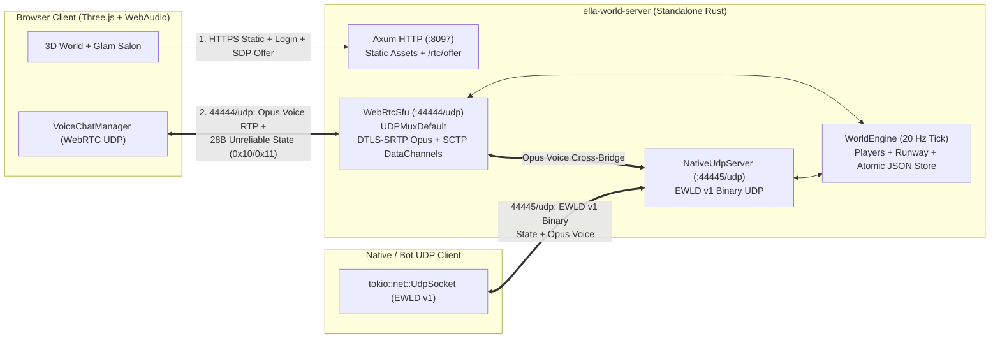

# ELLA World — Rust UDP Architecture & Binary Wire Protocol

## 1. System Overview

ELLA World is architected as a self-contained Rust process (`ella-world-server`) with zero runtime dependencies on Node.js, Express, Server-Sent Events (SSE), HTTP `/sync` polling, or external databases.

---

## 2. Why Single-Port Multiplexed UDP (`44444/udp`)?

Standard WebRTC servers allocate random ephemeral UDP ports (e.g., `10000–60000/udp`) for every peer and audio track, forcing operators to expose tens of thousands of UDP ports on their router.

`src/webrtc_sfu.rs` binds **one `tokio::net::UdpSocket` on `44444/udp`** wrapped in `webrtc::ice::udp_mux::UDPMuxDefault`:

1. **Zero Ephemeral Port Sprawl**: Every browser player's ICE connectivity checks, `DTLS-SRTP` Opus audio packets, and `SCTP/DTLS` binary game-state datagrams multiplex cleanly over `44444/udp`.
2. **Dual LAN + WAN ICE Candidates & Bridge Filtering**: `SettingEngine::set_interface_filter` excludes virtual container bridges (`docker*`, `br-*`, `veth*`, `virbr*`), while `WebRtcSfu::inject_public_srflx_candidate` appends an RFC 8445 `typ srflx` candidate for `ELLA_PUBLIC_IP` alongside the server's physical LAN `typ host` candidate—enabling sub-millisecond local Wi-Fi play without router NAT hairpinning and seamless remote WAN play over the exact same `UDPMuxDefault` socket (`44444/udp`).
3. **Zero Head-of-Line Blocking**: Movement, animations, runway poses, and speaking indicators travel over `ella-udp-state` configured with `ordered: false, maxRetransmits: 0`. Dropped packets are never retransmitted—newer 20 Hz frames supersede older ones immediately.

---

## 3. Binary State Codec (`src/udp_wire.rs`)

Both WebRTC `ella-udp-state` (`44444/udp`) and Native `EWLD` (`44445/udp`) share the exact little-endian binary state frames:

### Client-to-Server `OP_C2S_STATE` (`0x10` — Fixed 28 Bytes)

| Byte Offset | Type | Field | Description |
| :--- | :--- | :--- | :--- |
| `0` | `u8` | `opcode` | `0x10` (`OP_C2S_STATE`) |
| `1..5` | `u32 LE` | `seq` | Monotonic sequence number (out-of-order stale packets dropped) |
| `5..9` | `u32 LE` | `client_time_ms` | Client monotonic ms timestamp echoed back for live RTT calculation |
| `9..13` | `f32 LE` | `x` | World X coordinate (`[-80.0, 80.0]`) |
| `13..17` | `f32 LE` | `y` | World Y elevation (`[-20.0, 80.0]`) |
| `17..21` | `f32 LE` | `z` | World Z coordinate (`[-80.0, 80.0]`) |
| `21..25` | `f32 LE` | `ry` | Character yaw rotation in radians |
| `25` | `u8` | `anim` | `0=idle`, `1=walk`, `2=run`, `3=jump` |
| `26` | `u8` | `emote` | `0=none`, `1=pose`, `2=peace`, `3=dance`, `4=spin`, `5=wave`, `6=cheer`, `7=flip`, `8=sit` |
| `27` | `u8` | `voice_flags` | Bit `0`: `muted`, Bit `1`: `speaking` |

### Server-to-Client `OP_S2C_WORLD_STATE` (`0x11` — Variable Compact Snapshot)

- Header (`11 bytes`): `[0x11][server_tick: u32 LE][echo_client_time_ms: u32 LE][player_count: u16 LE]`
- Per Remote Player (`1 + id_len + 19 bytes`): `[id_len: u8][id_utf8][x: f32 LE][y: f32 LE][z: f32 LE][ry: f32 LE][anim: u8][emote: u8][voice_flags: u8]`

### Native Raw UDP Envelope (`44445/udp`)

Raw UDP datagrams on `44445/udp` prefix a 6-byte magic header `[b"EWLD"][version = 1][pkt_type]` supporting:
- `0x01` `OP_HELLO` / `0x02` `OP_WELCOME` (HMAC session authentication)
- `0x10` `OP_C2S_STATE` / `0x11` `OP_S2C_WORLD_STATE` (20 Hz 3D movement & pose sync)
- `0x12` `OP_C2S_PING` / `0x13` `OP_S2C_PONG` (NAT pinhole keepalive & RTT probe)
- `0x20` `OP_VOICE_OPUS` (`[seq: u16 LE][timestamp: u32 LE][opus_frame...]` relayed to native peers & bridged into WebRTC SFU `TrackLocalStaticRTP`)
- `0x30` `OP_EVENT_JSON` / `0x31` `OP_EVENT_ACK` (reliable acknowledged voxel block, outfit, chat & runway commands)

---

## 4. Atomic Disk Persistence (`src/persistence.rs`)

All persistent state lives in `ELLA_DATA_DIR` (e.g., `/var/lib/ella-world/`):
- `world_users.json`: Whitelisted friend accounts, outfits, master admin password, and throttled `lastPos` builder coordinates (`chmod 0600` on Unix).
- `world_blocks.json`: Monotonically versioned co-op voxel blocks (`blocksVersion` + `blocks[]`).

Writes serialize to `.tmp.<pid>` in the same directory and execute an atomic POSIX `rename()` so power loss or process restarts can never corrupt world files.
